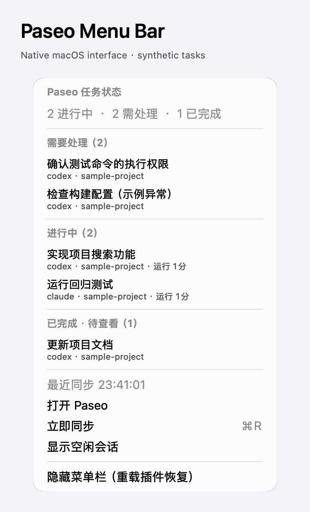

# Paseo Menu Bar

See running tasks, permission requests, errors, and completed tasks awaiting your attention in the macOS menu bar. Open the menu to see task names, providers, project folder names, and running time. Selecting a task opens that conversation in Paseo.

The menu follows a live subscription to the daemon's public, unarchived agent directory. It periodically reconciles the directory and marks failed synchronization as offline instead of presenting cached counts as current. Completed means Paseo has marked an agent as finished and awaiting attention, not a cumulative count of turns. Idle conversations can be shown with a menu option.

## Setup

Requires macOS 13 or later, an active graphical login session, and Paseo `>=0.14.0-beta.1 <0.16.0` on both the daemon and connected client. Install it on the Mac running the daemon; a plugin on a remote Linux host cannot draw a menu bar on your Mac. Use one instance per daemon. Apple Silicon has been tested locally; Intel builds use the local Swift compiler but have not yet been hardware-tested locally.

Apple Command Line Tools must already be installed. On first activation, the plugin uses the existing `/usr/bin/xcrun swiftc` to compile its bundled, readable Swift source into a private local application cache. It does not download software or install Command Line Tools for you.

Connect a Paseo client once to initialize observation, or let the next task or permission event initialize it. Observation then belongs to the server and continues when that client closes, provided the daemon remains running. Until initialization, the menu shows that it is waiting for a connection.

## Data and controls

Only task IDs, sanitized titles, providers, project folder names, status, timestamps, and Paseo conversation links are passed to the native helper through a private process pipe. The plugin does not request conversation timelines, read account credentials, or send task data to third-party services. Task status stays in memory; compiled application code and the idle-visibility preference are retained locally. Titles and project names may be sensitive and are visible in the menu.

The menu lists up to 100 tasks while counting the complete eligible directory. Permission requests and errors appear first. Authorization and task actions remain in Paseo; the menu does not approve tools, send prompts, or interrupt tasks. Hiding the menu does not stop tasks; reloading the plugin restores it. Disabling or removing the plugin stops observation and the helper.

The native interface currently uses Simplified Chinese labels. The image below uses synthetic tasks and captures only the preview process's own native views, not a production desktop or real conversations.

