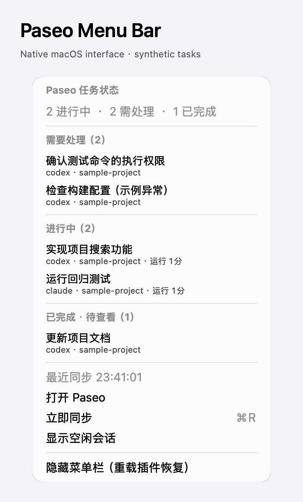

# Paseo 菜单栏

在 macOS 菜单栏查看进行中的任务、等待授权、异常和已完成待查看的会话。展开菜单可看到任务名、provider、项目目录名和运行时长，点击任务即可打开 Paseo 中的对应会话。

状态来自 daemon 公开、未归档 Agent 目录的实时订阅，并定期完整对账。同步失败会显示离线，不把旧计数伪装成实时状态。「已完成」指 Paseo 标记的完成且待查看的 Agent，不是累计 turn 数。菜单中可选择是否显示空闲会话。

## 使用条件

需要 macOS 13 以上、图形登录会话，以及 daemon 和连接客户端均为 Paseo `>=0.14.0-beta.1 <0.17.0`。插件应装在运行 daemon 的 Mac 上；远程 Linux 上的服务端插件不能绘制本机 Mac 菜单栏。每个 daemon 使用一个实例。Apple Silicon 已在本机验证；Intel 使用本机 Swift 编译路径，尚未经本机 Intel 硬件测试。

必须事先安装 Apple Command Line Tools。首次启用时，插件通过现有的 `/usr/bin/xcrun swiftc` 编译随包提供、可审阅的 Swift 源码，将生成的小组件缓存到本机私有目录。插件不下载软件，也不会替你安装 Command Line Tools。

连接一次 Paseo 客户端可初始化订阅；下一次任务或权限事件也会初始化。此后订阅属于服务端，只要 daemon 继续运行，关闭该客户端不会停止观察。尚未初始化时，菜单会如实显示等待连接。

## 数据与控制

原生组件仅通过私有进程管道接收任务 ID、清理后的标题、provider、项目目录名、状态、时间和 Paseo 会话链接。插件不会请求会话 timeline、读取账号凭据或向第三方发送任务数据。状态仅驻内存；本机会保留编译后的程序缓存和空闲会话显示偏好。任务标题和项目名可能敏感，会在菜单中可见。

菜单最多列出 100 个任务，但计数覆盖完整的符合条件的目录，优先显示权限请求和异常；归档、已关闭、internal 和 background helper 不计入。授权和任务操作仍在 Paseo 内完成，本插件不会代为批准工具、发消息或中断任务。隐藏菜单栏不会停止任务，重载插件可恢复；停用或卸载插件会停止订阅和原生进程。

当前原生界面使用简体中文。下图使用合成任务，仅捕获预览进程自身的原生视图，不包含生产桌面或真实会话。

