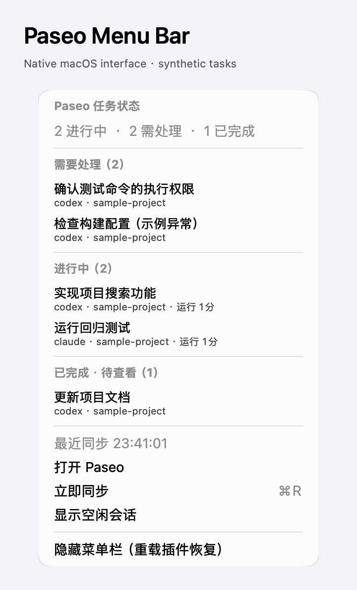

# Paseo Menu Bar

在 **macOS 菜单栏**实时查看 Paseo 任务状态。独立 Paseo 插件 + 原生 Swift/AppKit 小组件，不依赖 Electron、SwiftBar 或 xbar，不占 Dock，不修改其他插件。

[English overview](OVERVIEW.md) · [中文市场介绍](OVERVIEW.zh-CN.md) · [发布与审核流程](docs/PUBLISHING.md)



图片捕获临时预览进程自身的真实 AppKit 菜单，只有合成任务，不是生产桌面或真实任务截图。

```text
菜单栏：  ⟳ P 2 · !1        = 2 个任务进行中，1 个需要处理
          ✓ P ✓3           = 3 个任务已完成、待查看
          ◷ P …            = 等待 Paseo 连接
          ⊘ P 离线         = 同步失败，不能把旧状态当作当前状态
```

实际显示为 macOS SF Symbols 图标，不是上述示意字符。

## 功能

- 实时 SDK 订阅，约 100 ms 合并一次更新；持续高频事件不会饿死界面。每 30 秒重建订阅并对账，发现断线或遗漏。
- 区分 **运行中 / 启动中 / 等待授权 / 异常 / 已完成待查看 / 空闲**。等待授权优先于底层 `running`；不会把所有 idle 会话误报为完成。
- 下拉按「需要处理」「进行中」「已完成」分组；显示任务标题、provider、项目目录名、运行时长；点击跳转到该主机的对应 Paseo 会话。
- 可选显示空闲会话，手动同步，打开 Paseo，临时隐藏菜单栏。下拉菜单在打开时取最新状态；展开期间不重排条目，以免误点。
- 支持目录分页；菜单最多列出 100 个会话，但计数覆盖完整的公开、未归档任务目录。归档、已关闭和 internal helper 不计入。
- 断线明确显示「离线」和过期提示；保留上次状态，不伪装成成功或 0 个任务。
- 插件禁用、卸载、重载时停止订阅及原生进程；父进程死亡时通过 stdin EOF 退出，不残留菜单栏。原生组件崩溃最多自动重试 3 次。

「已完成」依据 Paseo 的 `requiresAttention + attentionReason=finished`，指**完成且待查看的 Agent**，不是每个会话的累计执行次数。查看后 Paseo 清除关注标记，即恢复空闲。权限确认仍需在 Paseo 内操作，本插件不会代为授权、发消息或停止任务。

## 要求

- **macOS 13+**，本机有图形登录会话。Apple Silicon 已实测；Intel 有本机编译路径，尚未经 Intel 硬件验证。
- daemon 和连接客户端均为 **Paseo >=0.14.0-beta.1 <0.16.0**。真实编译器/IPC 测试覆盖 0.14.0-beta.1 和 0.15.0-beta.1。
- Apple Command Line Tools（`xcrun swiftc`）。没有时，由你运行 `xcode-select --install` 安装。首次启用编译原生小组件，后续复用源码哈希 + CPU 架构缓存。
- 开发检查使用 Node.js >=22.12；源码安装没有额外的运行时 npm 依赖，SDK 和 Zod 由 Paseo 提供。

**安装在 daemon 所在的 Mac 上。** 服务端插件不能在远程 Linux 主机上绘制你本机 Mac 的菜单栏，也不会把多个 daemon 合并成一个菜单栏。非 macOS 宿主安全地返回 unsupported，不启动进程。每个 daemon 只安装一个实例。

## 安装

先信任源码：Paseo 插件是**无沙箱、受信任代码**，拥有 daemon 用户的文件访问权限。本项目不替你开启全局第三方插件开关、不升级 Paseo、不重启生产 daemon。

```bash
cd "/absolute/path/to/paseo-menubar"
npm ci --ignore-scripts
npm run check

# 使用与桌面 daemon 匹配的 CLI，避免误用旧的全局 paseo：
PASEO="/Applications/Paseo.app/Contents/Resources/bin/paseo"
"$PASEO" --version
"$PASEO" plugin install "$PWD"
"$PASEO" plugin ls
```

安装前同时核对**目标 daemon**版本；CLI 版本本身不能证明 daemon 版本。若应用不在 `/Applications/Paseo.app`，修改上面的路径。

如果第三方插件尚未启用，请先在 Paseo 插件设置中确认信任并启用。安装后连接一次该主机的 Paseo 客户端，即可看到菜单栏。

公开源码：[ketitongxue/paseo-menubar](https://github.com/ketitongxue/paseo-menubar)。官方市场收录需要审核，GitHub Release 或收录申请本身不代表已经上架。审核前也可以使用直接 Git 来源：

```bash
"$PASEO" plugin install git:ketitongxue/paseo-menubar --ref v0.1.0
```

这是源码安装地址，不是官方市场安装 ID。

### 为什么首次需要连接客户端？

Paseo 0.14/0.15 的服务端 SDK 只在 RPC 或生命周期事件中提供 daemon API。插件在加载时启动菜单栏，通过任意连接客户端的一次自动 RPC 初始化实时订阅；没有客户端时，下一次任务/授权/工作区事件也会初始化。**初始化后订阅属于服务端，关闭客户端窗口不影响继续显示**（前提是 daemon 本身仍在运行）。纯无客户端且无新事件时，菜单栏如实显示等待连接，而不是伪造任务计数。

临时隐藏菜单栏不停止任务。恢复、更新源码或排查后重新编译：

```bash
"$PASEO" plugin reload paseo-menubar
"$PASEO" plugin logs paseo-menubar

# 停用 / 卸载：
"$PASEO" plugin disable paseo-menubar
"$PASEO" plugin remove paseo-menubar
```

重载会清理旧进程。源码没变时不会重复编译 Swift。无需单独注册登录启动项；菜单栏随 Paseo 插件生命周期启动和停止。

## 不安装也能预览

```bash
npm run demo
```

显示合成示例，每 5 秒切换运行中 → 等待授权 → 已完成。Ctrl+C 或「隐藏菜单栏」退出；不连接生产 daemon、不读取账号、不安装插件。示例不能跳转真实会话。

## 数据与安全

```text
$PASEO_HOME/menubar/                     # 默认 ~/.paseo/menubar/
  native-<source-hash>-<arch>.app/        # 原生可执行程序缓存
  helper.lock                           # 同一 daemon 防重复启动
```

- 新建数据目录 `0700`。任务状态仅驻内存，经父子进程的私有 stdin 管道传递，不写状态文件、不开放监听端口、不向第三方发请求。
- 原生进程仅接收 ID、清理后的标题、provider、项目目录名、状态、时间及 Paseo 深链接，不接收权限内容、错误正文、绝对工作目录、会话正文或凭据。不会请求 timeline、打开 provider 会话或读取账号认证文件。
- 原生进程使用最小环境，不继承 provider token、daemon 密钥等 shell 环境变量。
- 唯一持久化 UI 偏好是系统 `UserDefaults` 的「显示空闲会话」。卸载不删除可复用的原生缓存；确认停用后可自行删除 `menubar` 目录。
- 安全边界及限制见 [SECURITY.md](SECURITY.md)。分发采用公开 GitHub 源码，不发布 npm；官方市场状态以官方审核与目录为准。

## 开发与验证

```bash
npm run generate       # 修改 native/main.swift 后，更新嵌入的 Swift 源码
npm run build:native   # 手动编译原生组件，输出可执行文件路径；不启动 GUI
npm run screenshot     # 仅 macOS；合成数据的原生菜单截图，不捕获其他窗口
npm run check          # 源码一致性、类型、lint、测试
npm pack --dry-run     # 检查发布文件，不安装插件
```

验证包括：状态映射/隐私字段过滤、持续事件节流、分页与并发更新/删除、重连替换与过期请求、断线恢复、客户端启动重试、管道背压、原生进程重启/清理、真实 Swift 可执行程序的无界面协议/持续小消息读取测试，以及两版 Paseo 的真实编译器和插件子进程 IPC 测试。IPC 测试仅替换 OS GUI 边界，使用临时目录、合成任务及假宿主会话；不会访问生产 daemon 或运行模型任务。

```text
index.client.tsx → 自动 bootstrap RPC
index.server.ts  → 生命周期引导 / TaskObserver → 私有 JSONL → Swift/AppKit 菜单栏
                                            ← refresh / hide
```
